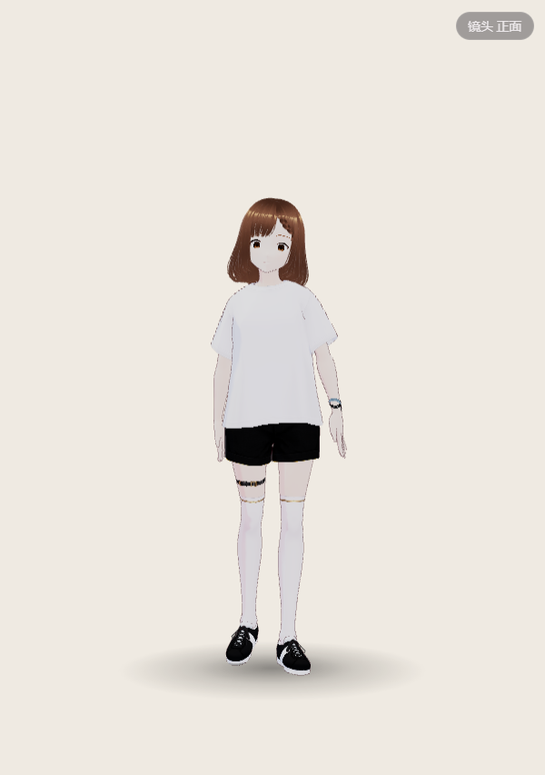
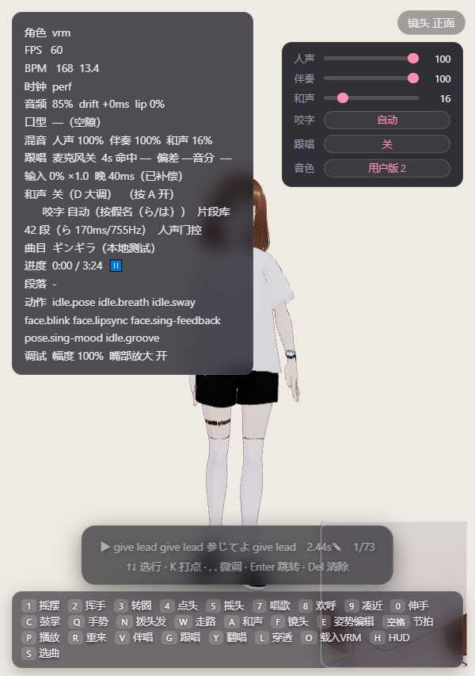

# AI 伴唱桌宠 · 开发预览（0.0.1）

Windows 桌面上的 3D 虚拟歌手：透明置顶窗口 + VRM 角色 + 跟着你自己的歌跳舞、唱和声、
跟你一起唱（麦克风判定）。中 / 日 / 英三语。
（自己做着玩的没用小玩具，部分功能做的很粗糙，后续也不太准备维护了。）

> ## ⚠️ 这是**开发预览**，不是完整产品
>
> | 能做什么 | 还不能做什么 |
> |---|---|
> | 桌面上站着一个会呼吸、会眨眼、会跟着节拍晃的角色 | ❌ **没有自带任何曲目**（版权原因） |
> | 15 个动作（挥手、转圈、走两步真的走开…）、右键菜单、托盘、点击穿透 | ❌ **安装包里没有「导入歌曲」**（要 Python 3.12 + ~3 GB 依赖） |
> | 载入你自己的 `.vrm`、切镜头、中/日/英切换 | ❌ 没有自动更新、没有崩溃上报 |
> | **做曲包**（导入自己的歌）：装一个约 250 MB 的可选组件就行，右键菜单 →「做曲包组件…」 | ⚠️ 打包版**没有代码签名**（SmartScreen 会提示「未知发布者」） |
>
> **所以现在装上之后，她能站在桌面上、做动作、说话；想让她唱，得先自己做/装一个曲包**
> （安装包不带曲目，也不带做曲包要的 Python 工具链，后者是 Release 里的
> `ai-companion-singer-creator-pack.zip`）。
>
> 安装包在 [Releases](../../releases)，`SHA256SUMS.txt` 一起给。



## 1. 这是什么

| 层 | 做法 |
|---|---|
| 桌面壳 | Electron 透明置顶窗 + 点击穿透（全局光标命中测试）+ 托盘 + 全局快捷键 |
| 3D 角色 | three.js + `@pixiv/three-vrm`，54 根人形骨全映射，表情 / 口型 / 视线驱动 |
| 动作系统 | 手摆的姿势库 → 关键帧剪辑 → ParamBus 分层混合 → 脚部 IK（脚不滑不穿地）+ 世界坐标手臂 IK + BVH 重定向（走两步） |
| 唱歌链路 | 曲包（你自己的歌）→ 人声分离 → 参考音高 → 逐字口型 → 编舞；跟唱用麦克风 YIN 判定；和声用 48 段 SVC 采样实时变调 |
| 多语言 | 中 / 日 / 英，静态界面 + 原生菜单 + 她的台词都跟着切 |

按 `H` 打开面板（HUD + 混音条 + 键位提示）：



四条技术链路（透明窗 / VRM / 动作 / 音频时钟）在 P0 阶段就已经全部跑通，
后面都是在这四条链路上加功能。下面这份是**开发文档**：为什么这么做、怎么验证、踩过哪些坑。

## 2. 现状（用真实 VRM 验证过的）

| 项目 | 结果 |
|---|---|
| 模型 | `models/saki.vrm`（VRM 1.0 / VRoid Studio 2.16，许可允许分发）；`models/text.vrm` 仅本地开发用 |
| 骨骼 | 54 根，必需骨无缺失 |
| 表情 | 14 个（含 aa/ih/ou/ee/oh/blink/happy…），全部可用 |
| 手臂自然下垂 | ✅ 已校正（`VRM_BASE_POSE`） |
| 节拍弹跳 | ✅ 膝盖弯曲方向正确 |
| 挥手 / 比耶 | ✅ 手臂抬起方向正确 |
| 表情驱动 | ✅ `pose.peace` 会闭眼笑 |

截图在 `shots/`（不随仓库发布，366 MB 实验素材，见 `.gitignore`）。

### ⚠️ 版权与授权（重要）

- **角色模型**：随发行版的是 `saki.vrm`（作者 **aq**，VRM 1.0）。它的许可允许分发/修改/商用，
  要求「不为过度暴力或性表现使用」。旧的 `text.vrm` 许可只到「作者本人 + 非商用」，**不能分发**，
  已从发行包里移除（仓库里也不提交）。
- **和声 / 起音采样**（`public/voices/*.wav`）：用 SVC 从**一首商业曲目的人声分轨**做音色转换
  后截取的稳态长音。**仅供个人学习研究，不要商用、不要再分发**；要公开发布请自己重烤
  （见 `docs/maintenance.md` 的和声流水线）。
- **曲目**：仓库不含任何曲包（`public/songpacks/` 已忽略）。

---

## 3. 运行

```powershell
pnpm install
pnpm dev      # 开发模式
pnpm start    # 构建后运行
```

**首次运行会自动探测可用的启动参数**（约 3～5 秒），结果缓存在 `.tmp/launcher-state.json`，
之后启动就是秒开：

```
[launcher] 首次运行，探测可用的启动方式…
[launcher]   ✗ 原样启动 — 无输出 (0x80000003)
[launcher]   ✗ 关闭 Chromium 沙箱 — boot (0xc0000005)
[launcher]   ✗ 软件渲染 — boot (0xc0000005)
[launcher] 可用：用户目录重定向到工作区
[launcher] (4/5 用户目录重定向到工作区) electron --no-sandbox --user-data-dir=… .
```

想重新探测：删掉 `.tmp/launcher-state.json`，或跑 `pnpm diagnose`。
升级 Electron 后缓存会自动失效（指纹里带版本号）。

如果 `node_modules/electron/dist/electron.exe` 不存在（pnpm 拦了 postinstall）：

```powershell
node node_modules/electron/install.js
```

### 故障排查

**先跑 `pnpm diagnose`。**（注意不是 `pnpm doctor`——那是 pnpm 内置命令，会把同名脚本盖掉。）

它会先报告环境，再用 5 组参数依次启动一个最小 Electron 应用：

```
=== 环境 ===
APPDATA      可写: false      ← 这个为 false，Chromium 基本必挂
LOCALAPPDATA 可写: false
工作区       可写: true

=== 启动测试 ===
[0] 原样启动 … ❌ 无输出 (exit 0x80000003)
[1] 关闭 Chromium 沙箱 … ❌ boot (exit 0xc0000005)
...
```

`boot` 表示主进程起来了但没到 `app.whenReady()`，`ready` 表示完全正常。

**最快的绕开方式：双击项目根目录的 `run.bat`。**
它从资源管理器启动，不继承当前终端的任何环境变量，并把用户目录重定向到工作区。

#### 常见退出码

| 退出码 | 十六进制 | 含义 |
|---|---|---|
| `-2147483645` | `0x80000003` | Chromium 沙箱初始化失败，加 `--no-sandbox` |
| `-1073741819` | `0xC0000005` | 访问违例，主进程在 Chromium 初始化阶段崩 |
| `4294930435` | `0xFFFF7003` | crashpad 连不上，通常是会话/权限受限 |

#### 已知的两个坑

1. **参数没被传给 Electron**
   旧版 `scripts/dev.mjs` 写死了 `spawn(electronPath, ['.'])`，
   `pnpm dev --no-sandbox` 的参数会被吞掉，Electron 仍无参数启动并崩在沙箱上。
   现在已改为透传 `process.argv.slice(2)`，`[launcher]` 行会打印实际生效的参数。

2. **`ELECTRON_RUN_AS_NODE=1` 被继承**
   Electron 会被当成普通 Node 跑，`require('electron')` 返回路径字符串，
   `app.commandLine` 直接 undefined。启动器会自动删除这个变量。

#### 不要用的参数

- `--disable-software-rasterizer`：它会关掉 WebGL 的软件回退。
  和 `--disable-gpu` 一起用等于彻底没有 WebGL，窗口能开也是黑的。
- 如果确实需要软件渲染，用 `--disable-gpu --enable-unsafe-swiftshader`。

#### 所有组合都失败怎么办

说明当前会话无法创建 Chromium 窗口进程，典型原因：

1. **`%APPDATA%` / `%LOCALAPPDATA%` 不可写**（最常见）
   Chromium 主进程启动前要往这两个目录写配置和崩溃转储，写不了就在 `app.whenReady()` 之前退出。
   `pnpm diagnose` 的「环境」段落会直接告诉你。用 `run.bat` 或把用户目录重定向到工作区。
2. **从服务会话 / 计划任务（session 0）启动**，没有交互桌面
3. **从 IDE 内置终端或远程会话启动**，进程令牌受限
4. **杀毒软件 / 组策略**拦截 Chromium 子进程

优先用正常登录的桌面终端直接 `pnpm dev`，或双击 `run.bat`。

---

## 4. 快捷键

| 键 | 作用 |
|---|---|
| `1` | 摇摆（跟随节拍，左右重心交替，循环开关） |
| `2` | 挥手 |
| `3` | 转圈 |
| `4` | 点头 |
| `5` | 摇头 |
| `6` | 比耶 |
| `7` | 唱歌姿势（一手前伸掌心向上、一手抚胸） |
| `8` | 欢呼（真跳：屈膝蓄力 → 蹬伸离地 15 cm → 顶点悬停 → 落地缓冲） |
| `9` | 凑近镜头（上身前倾探过来） |
| `0` | 向前伸手 |
| `C` | 鼓掌 |
| `F` | 切换机位（正面平视 / 角色右上方，右上角按钮同一个作用） |
| `E` | 姿势编辑器开关（打开后窗口放大；**拖角色可转视角**） |
| `X` | 动作幅度：35% → 100% → 0（确认口型时按到 0，全身停住只看嘴） |
| `Z` | 嘴部放大副视口（右下角，约 4.3 倍） |
| `T` | 假口型开合（验证「音频 → 表情」链路） |
| `空格` | 节拍器（验证「音频时钟 → 节拍网格 → 动作同步」） |
| `B` | 切换 BPM |
| `L` | 锁定/解锁点击穿透 |
| `O` | 载入 VRM |
| `H` | HUD + 混音条 + 键位提示（**默认关**，2026-11-18 起；第一次用按一下，状态会记住） |
| `P` | 曲包播放 / 暂停 |
| `R` | 曲包从头开始 |
| `M` | 静音开关 |
| `[` `]` | 音量 -10% / +10% |
| `K` | 歌词打点：把焦点行钉在当前时间 |
| `↑` `↓` | 移动歌词焦点行（可回头重打任意一行） |
| `,` `.` | 焦点行时间 -50ms / +50ms（按住 Shift 为 ±10ms） |
| `Enter` | 跳到焦点行的时间 |
| `Del` | 清除焦点行的时间 |
| `Shift+Del` | 从焦点行起全部清空（重新打点） |
| `Shift+K` | 撤销上一次打点 |

### 全局快捷键

窗口平时没有焦点，普通按键收不到，所以主要动作都注册了**全局快捷键**（任何程序在前台都生效）：

| 全局快捷键 | 作用 |
|---|---|
| `Ctrl+Alt+1` ~ `Ctrl+Alt+6` | 摇摆 / 挥手 / 转圈 / 点头 / 摇头 / 比耶 |
| `Ctrl+Alt+7` | 唱歌姿势 |
| `Ctrl+Alt+8` | 欢呼 |
| `Ctrl+Alt+9` | 凑近镜头 |
| `Ctrl+Alt+C` | 鼓掌 |
| `Ctrl+Alt+F` | 切换机位（正面平视 / 角色右上方） |
| `Ctrl+Alt+E` | 姿势编辑器开关 |
| `Ctrl+Alt+T` | 假口型 |
| `Ctrl+Alt+X` | 动作幅度循环（35% / 100% / 0） |
| `Ctrl+Alt+Z` | 嘴部放大开关 |
| `Ctrl+Alt+0` | 节拍器 |
| `Ctrl+Alt+H` | 调试面板 |
| `Ctrl+Alt+L` | 锁定 / 解锁点击穿透 |
| `Ctrl+Alt+Q` | 退出 |

注册失败会在启动日志里打印（通常是被其他程序占用了）。

### 窗口操作

| 操作 | 效果 |
|---|---|
| **按住角色拖动** | 移动窗口 |
| **右键角色** | 打开菜单（大小 / 重置位置 / 穿透锁定 / 动作 / 载入 VRM / 退出） |
| **Ctrl + 滚轮** | 缩放窗口（角色跟着放大缩小） |
| `Ctrl+Alt+Q` | 退出 |

窗口位置和大小会记在 `data/config.json` 的 `window` 字段里，下次启动恢复。
如果窗口跑到屏幕外（换显示器等情况），会自动拉回主屏右下角。

> **拖拽时尺寸被钉死**：无边框透明窗口在 Windows 上移动时系统会按 DPI 重新换算尺寸，
> 每拖一次涨一点。修法是三件事一起做：
> 1. 不用 `setPosition`，用 `setBounds` 把宽高一起写回
> 2. 尺寸只由「权威值」`canonicalSize` 决定（预设 / 缩放 / 启动恢复时更新），
>    **拖拽全程不回头读 `getBounds()`**——否则 1px 的取整误差会被下一次拖拽当基准，滚成雪球
> 3. 移动中、松手后各校一次，防止系统在收尾时改尺寸

### 取景余量

相机按「静止包围盒 + 上方 24% 余量」取景，因为挥手、举手会超出静止姿势的范围。
窗口尺寸变化时会自动重新取景，保证任何长宽比下都不裁切肢体。

### 两个机位

| 机位 | 是什么 | 怎么切 |
|---|---|---|
| 正面（默认） | 正对角色平视 | 右上角按钮 / `F` / `Ctrl+Alt+F` |
| 右上方 | 相机在角色右手边偏上，约 27° 的 3/4 视角，视线略微向下 | 同上，再按一次切回 |

机位是 `stage` 里的两个状态量：`orbit`（绕角色转）和 `elev`（比注视点高多少米）。
构图（距离 / 注视高度）和机位分开，所以改窗口大小、开姿势编辑器都不会把机位冲掉。
调试用的 `?orbit=<度>` 仍然优先于机位选择（截图核对前后深度时用）。

### 托盘

图标在 `electron/icon.ico`（8 种尺寸），代码里会缩放到 16×16 再交给 Windows
——直接塞 256×256 有些环境会渲染成空白。

**Windows 10 会把新注册的托盘图标默认收进溢出区**：任务栏右下角点 `^`，
把粉色音符拖到常驻区。

排查用 `data/main.log`：

```
[boot] electron 33.x / chrome 130.x
[tray] 用路径创建成功: icon.ico
[tray] getBounds = 24x24 @ 1712,1040
```

关键看 `getBounds`：

- **有宽高**（如 `24x24 @ 1712,1040`）→ Windows 已分配位置，图标在通知区里
- **`0x0 @ 0,0`** → 系统拒绝分配位置，图标一定不会出现

`0x0` 的常见原因，按可能性排序：

1. **安全软件接管了通知区**（腾讯电脑管家、360 等），拦截了新程序的托盘图标
2. Windows 设置 → 个性化 → 任务栏 →「选择哪些图标显示在任务栏上」里被关掉
3. 组策略统一隐藏了通知区图标

代码里做了对应处理：
- 延迟 1.2s 创建（等渲染层就绪，状态提示才收得到）
- 拿不到位置时**销毁重建一次**
- 右键菜单和托盘菜单里都有「任务栏图标设置…」，直接跳到系统设置页
- 状态会以横幅形式显示在窗口里，不用翻日志

> 托盘不是必需的。所有功能在**右键菜单**里都有，托盘只是锦上添花。

**拿不到位置时的退化行为**：窗口会重新出现在任务栏上（`setSkipTaskbar(false)`），
保证至少有一个入口，不会变成「找不到程序也没法关闭」。

另外注意 `tray.getBounds()` 返回 `0x0` 有两种含义：一种是系统真的拒绝分配，
另一种是**图标在溢出区里还没被布局**——打开 `^` 展开后重新查才会返回真实值。
所以 `0x0` 本身不能 100% 断定被拦截，还要看展开区里到底有没有。

> 注意：`electron.exe` 是 GUI 子系统程序，主进程的 `console.log` 在 Windows 终端里
> **看不到**，所以关键状态都写进了 `data/main.log`，看那个文件。

---

## 5. 架构

```
electron/main.cjs        透明窗、置顶、点击穿透、托盘、文件 IPC
electron/preload.cjs     contextBridge 暴露的 window.pet
src/main.ts              装配 + 主循环
src/core/clock.ts        MasterClock（perf/audio 双模）+ BeatClock + Metronome
src/core/paramBus.ts     参数总线：多源姿态混合
src/core/types.ts        统一动作接口的类型定义
src/rig/rig.ts           角色后端抽象
src/rig/primitiveRig.ts  程序化占位角色（VRM 加载失败时的兜底）
src/rig/vrmRig.ts        VRM 后端
src/actions/index.ts     动作库（待机 / 舞蹈 / 手势 / 表情）
src/scene/stage.ts       渲染器、灯光、接触阴影
src/ui/hud.ts            调试面板与提示条
```

### 核心抽象：参数总线

所有驱动源（编舞时间轴、LLM 指令、音频驱动、待机物理）都写成 `ActionClip`，
往 `ParamBus` 里塞同一种「姿态增量」，rig 只读最终结果：

```ts
type ActionClip = {
  id: string
  layer: 'base' | 'upper' | 'face' | 'additive'
  duration: number            // Infinity = 循环
  priority: number
  interrupt: 'soft' | 'hard' | 'none'
  blendIn: number
  blendOut: number
  sample(t: number, ctx: { time, dt, beat }): PoseDelta
}
```

混合规则：

- `base` / `upper` / `face` → 按权重求平均（新动作淡入时自然接管）
- `additive` → 直接相加（呼吸、摆动、视线这类常驻微动）

**换角色不需要改任何动作代码**：`VrmRig` 和 `PrimitiveRig` 实现同一个 `HumanoidRig` 接口，
动作按「手臂自然下垂」为原点编写，两个后端各自用 `basePose` 把静止姿态拉齐。

### 脚部锁定（P9）

姿势系统只会「绕关节转」+「整体平移髋」。所以任何让髋动起来的动作
（摇摆的侧移、凑近的坐下、转圈的整体旋转）都会把脚一起带走——看起来就是在地上滑。

`src/rig/footLock.ts` 在**姿势算完之后、渲染之前**做一层后处理：

```
脚踝贴着地  →  锁定：记下这个点，之后每帧用两骨 IK 把脚踝解回这个点
脚踝抬起来  →  松开：交还给动画，不干预
```

解算在 `VrmRig.solveLeg()`：余弦定理求膝角、大腿朝「角色前方」偏一个髋角、
转骨骼时用世界空间的增量四元数再换回局部。脚掌的世界朝向会钉住
（只跟着髋的偏航一起转），所以脚不会跟着腿翻棱。

实测（`?ik=0` 关掉做对比，承重脚的水平位移）：

| 动作 | 关掉 IK | 打开 IK |
|---|---|---|
| 转圈（360°） | X 21 cm / Z 32 cm | **X 0.2 cm / Z 0.5 cm** |
| 摇摆（左右各 3 cm 侧移） | Z 18–27 cm | **0–0.4 cm** |
| 凑近（髋后退坐下） | Z 6.5 cm | **0–0.8 cm** |

它是纯后处理，**作者摆的姿势一句都不用改**。跳起来的时候两只脚都会离开地面，
自动松开，不干预腾空。已知边界：脚被钉住之后膝和踝是解出来的，
极限姿势会被腿长钳制，脚可能差几厘米。

**「动作做完要交还给站姿」**——这条是踩坑之后补的：

- 锁定只在**有动作在跑**时生效（`ParamBus.hasAction()`）。没动作时锚点跟着脚走，
  下一次动作从「现在的位置」接管。不这么做的话，跳完之后脚会一直钉在落地那次的位置，
  **之后每个动作都带着那个偏移**。
- 锚点取的是**动作起手前一帧**的脚踝，不是起手那一帧——那一帧姿势已经混进去 30% 了，
  拿它当锚点会直接偏几厘米。
- 「踩在地上」的参考高度是**每只脚各自**的：作者的站姿一只脚高一只脚低（差 3 cm），
  共用一个阈值会让高的那只永远算「抬着」。

实测「动作播完后脚回到闲置位置」偏差（多次采样，待机自身摇摆的噪声是 7~12 mm）：

| 动作 | 左 / 右 |
|---|---|
| 欢呼 | 7.2 / 6.8 mm |
| 转圈 | 6.3 / 5.9 mm |
| 挥手 | 5.8 / 5.6 mm |
| 点头 | 7.7~14.8 / 6.6~11 mm |
| 凑近 | 0 / 0 mm（测量窗口内已经回位） |

**静息站姿是它自己（`idle.pose`）**：站姿由作者在编辑器里摆（`userPoses.ts` 的 `stance`），
常驻在 `base` 层、优先级最低。所有一次性动作的首帧和尾帧都是这个姿势，动作淡出之后也回到它——
不然动作一停，人会掉回「手臂下垂、双腿笔直」的僵硬样子，终点和起点对不上。
它带 `neutral: true`：按 `X` 把动作幅度调到 0 时它不跟着缩放，否则整具身体会退回 T-pose。

---

## 6. 曲包 `.songpack`

一个曲包是一个目录，放在 `public/songpacks/<id>/` 下：

```
public/songpacks/
  index.json              曲包索引
  demo/
    pack.json             元信息
    actions.json          编舞时间轴
    stems/                音频分轨（后续）
    chart.json            音符谱面（后续，演唱反馈用）
    lyrics.json           字级歌词（后续）
    viseme.json           口型曲线（后续）
```

`index.json` 登记可用曲包，新增曲包要手动加一行：

```json
{ "schema": 1, "packs": ["demo"] }
```

`pack.json`：

```json
{
  "schema": 1,
  "id": "demo",
  "title": "起手式 Demo",
  "bpm": 96,
  "beatsPerBar": 4,
  "duration": 32,
  "loop": true,
  "choreography": "actions.json",
  "assets": { "instrumental": null, "vocal": null, "chart": null, "lyrics": null, "viseme": null }
}
```

`actions.json`：

```json
{
  "duration": 32,
  "sections": [{ "at": 10, "name": "verse", "energy": 0.45 }],
  "cues": [
    { "at": 10, "clip": "dance.bounce" },
    { "at": 12.5, "clip": "pose.peace", "weight": 1 },
    { "at": 30, "action": "stop", "clip": "dance.bounce" }
  ]
}
```

- `at` 单位是**秒**（浮点），想按拍写就自己换算：`秒 = 拍 × 60 / bpm`
- `clip` 必须是 `src/actions/index.ts` 里注册过的动作 id
- `action: "stop"` 用来关闭循环动作
- `sections` 只影响 HUD 和后续的段落逻辑，不驱动动作

加载时会跑一遍校验（schema、时长、cue 越界、未知动作），问题打印在控制台，
有问题的曲包仍然会载入，只是对应的 cue 会被跳过。

**换曲包**：改 `index.json` 的顺序，或用 URL 参数 `?pack=<id>`。

### 伴奏音频

`pack.json` 里 `assets.instrumental` 指向曲包目录下的音频文件：

```json
"assets": { "instrumental": "stems/instrumental.mp3" }
```

播放时只截取 `[offset, offset + duration]` 这一段，所以可以拿一首完整歌曲配一段 32 秒的编舞。

**时钟取舍**：桌面端的待机和动作动画跑在 `performance` 时钟上，音频是按时间点调度过去的从属时钟。
没有把全局时钟切成音频时钟，是因为 `AudioContext` 暂停时时间会停，那样连呼吸眨眼都会冻住。
代价是长时间播放有极小漂移（~50ppm），HUD 上的 `drift` 就是用来观察这个的（正常值 ≈ +15ms，
即音频调度提前量）。真需要歌词级同步时再做周期性重同步。

> ⚠️ **demo 曲包里的 `stems/instrumental.mp3` 是本地测试素材，版权不属于本项目，不要随代码分发。**
> 正式发布前删掉，或换成免版税音源。

### 音频驱动的表现

两个不依赖歌词、也不依赖 viseme 数据的实时反馈：

| 动作 id | 层 | 驱动源 |
|---|---|---|
| `face.lipsync` | face | `AnalyserNode` 的音量包络（RMS），张嘴快、闭合慢 |
| `idle.groove` | additive | `beat.phase`，跟拍点头 + 慢速侧摆 |

口型是**按包络开合**，不区分元音 —— 代价是嘴型不准，好处是零素材、任何歌都能用。
接 viseme 时只要把 `createLipSyncClip` 的数据源从 `level()` 换成音素权重即可，管道不用动。

摇摆幅度刻意做得很小（头部 0.035 rad 量级）。参照 VTB 直播的实际情况，
观众要的是「有反应」，不是「在跳舞」。

两者都只在播放时生效：`lipLevel` 和 `grooveLevel` 每帧平滑趋近目标值，暂停时自然衰减到 0。

### 歌词与打点

`lyrics.json` 是**行级**时间轴：

```json
{
  "schema": 1,
  "language": "ja",
  "lines": [
    { "at": 12.34, "text": "give lead give lead 参じてよ give lead" },
    { "at": null,  "text": "ラルラ レイレイ ア ランラ レウ" }
  ]
}
```

`at` 为 `null` 表示这一行还没对时间。

**打点流程**（针对「有歌词文本但没有时间戳」这个最常见的情况）：

1. `P` 开始播放
2. 唱到下一行开头，按一次 `K`，焦点自动前进
3. 打错了：`↑` 把焦点移回那一行，再按一次 `K` 覆盖
4. 差一点点：`,` `.` 微调 50ms（Shift 为 10ms）
5. 想重听某行：`Enter` 直接跳到该行时间
6. 从某行开始整段重打：`Shift+Del` 清空该行及之后的所有时间戳
7. 每次改动后 0.7 秒自动写回 `lyrics.json`

字幕底板是一个半透明面板，压在角色身上也看得清。上面是当前行，下面是焦点行
（带时间戳和 `3/73` 进度）；HUD 打开时会多一行快捷键提示。

**载入时会检查时间倒序**：如果有相邻两行时间反了，横幅会提示并自动把焦点定位到第一个出问题的行。

也可以在浏览器模式之外用 `.lrc` 文件（`parseLRC()` 已实现，尚未接到加载流程）。

**为什么先做行级而不是逐音节口型**：日文歌词里大量汉字，逐音节需要假名读音（ふりがな）才能拆分和取元音。
这要靠强制对齐（WhisperX / MFA）或人工注音，属于后续的 L2 档。行级时间轴是字级对齐的骨架，
现在打通之后，L2 只是换数据源。

### 自动对齐（可选）

手动打点慢且容易出错，可以用 `tools/align_lyrics.py` 一次性对齐：

```powershell
pip install -U stable-ts
python tools/align_lyrics.py `
  --audio public/songpacks/demo/stems/instrumental.mp3 `
  --lyrics public/songpacks/demo/lyrics.json `
  --language ja --model medium
```

脚本会备份原文件为 `lyrics.json.bak`，再原地写回带时间戳的版本。

**为什么不用 Whisper 直接「识别」歌词**：

| | 解决什么 | 问题 |
|---|---|---|
| ASR（Whisper 转写） | 音频 → 文字 | 你已经有了文字；转写错误还会污染结果 |
| **强制对齐（本脚本）** | 文字 + 音频 → 时间 | 需要模型和一点算力，但结果直接可用 |

也就是说，先转写再对齐等于多做一步还引入额外误差，直接用已知文本对齐更准。

日文歌建议 `medium` 或 `large-v3`，`small` 在人声上经常对不准。
有分离出的人声轨时优先用干声，混音里伴奏会干扰对齐。

## 7. 调试参数

页面 URL 支持几个查询参数，方便无人值守验证：

| 参数 | 作用 |
|---|---|
| `?shot=1` | 深色背景（透明窗口截图看不见轮廓） |
| `?model=/models/text.vrm` | 直接从 URL 载入 VRM（浏览器模式用） |
| `?freeze=dance.wave&t=0.55` | 冻结在某个动作的某一帧 |
| `?pack=<id>` | 指定载入哪个曲包（默认取 index.json 里的第一个） |
| `?autoplay=1` | 载入后立刻从头播放 |
| `?hud=1` | 启动就打开调试面板 |
| `?motion=0.35` | 动作幅度（0 = 全身停住，只留口型/表情）。默认 1 |
| `?zoom=1` | 嘴部放大副视口 |
| `?pose=<id>` | 钉住姿势库里的一个姿势（`src/actions/poses.ts`），出姿势对照表用 |
| `?idle=0` | 关掉待机微动（呼吸/摇摆/跟拍），画面干净，配合 `?pose` 用 |
| `?ik=0` | 关掉脚部锁定（P9），用来对比「脚钉住 / 没钉住」的差别 |
| `?dbg=1` | 挂 `window.__pet`（应用任意姿势 + 读骨骼世界坐标），姿势数值标定用 |
| `?editor=1` | **姿势编辑器**：右侧面板选骨骼、拖滑杆改角度，按「复制 JSON」导出。桌面版会自动把窗口放大到 720×780 |
| `?vowel=a&lip=0.9` | **钉住**嘴型（`a/i/u/e/o/n/none`），用来逐个元音对比，不播音频也行 |
| `?mouth=-0.008` | 覆盖副视口的嘴部偏移（米，头骨坐标系），换模型时标定用 |

## 8. 辅助脚本

```powershell
node scripts/inspect-vrm.mjs models/text.vrm   # 检查骨骼/表情/许可
node scripts/serve.mjs 5199                    # 起静态服务器
node scripts/shot.mjs <url> <out.png> 6000     # CDP 无头截图（带控制台日志）
node scripts/build.mjs                         # 构建（固定 TEMP，绕开环境限制）
```

---

## 9. 这一版（0.0.1 开发预览）**没有**做的

| 缺的 | 为什么 / 现状 |
|---|---|
| **自带曲目** | 版权。仓库和安装包都不带歌，`public/songpacks/` 已 gitignore |
| **安装包里的「导入歌曲」** | 要 Python 3.12 + `.pylibs`（276 MB）+ SVC 权重（~2.5 GB）。打包版按 `I` 会直接提示「这个版本不含导入组件」；导入只在开发版可用 |
| **代码签名** | 没有证书。SmartScreen 会提示「未知发布者」，见 `docs/signing.md` |
| **自动更新 / 崩溃上报** | 没做，更新靠重新下载安装包 |
| **干净的和声素材** | 现在的采样来自商业曲目人声（见第 2 节版权声明），要公开发布得自己重烤 |
| **i / u / o 元音** | 和声与口型遇到只会退回「あ」，日语「無声化」也因此暂缓 |
| LLM 对话 / 指令解析 | 有意不做：云端成本、延迟、体验都不划算 |

完整的待做清单和每条的理由在 `docs/backlog.md`。

## 10. 已知问题（0.0.1）

- 没有曲目时进入「空状态」：能玩动作、能切语言，但唱不了（见第 9 节）
- `VRM_BASE_POSE`、嘴部偏移、取景都是按 `saki.vrm` 调的，换模型可能要微调
- 点击命中用包围盒近似，大幅度动作时边缘有几像素误差
- 只在 Windows 10（19045）/ 125% 缩放下验证过，Win11、150% DPI、多屏没测
- 没有长时间（数小时）播放的稳定性测试
- `tools/` 里的离线脚本需要自己装 Python 依赖，不在安装包里
